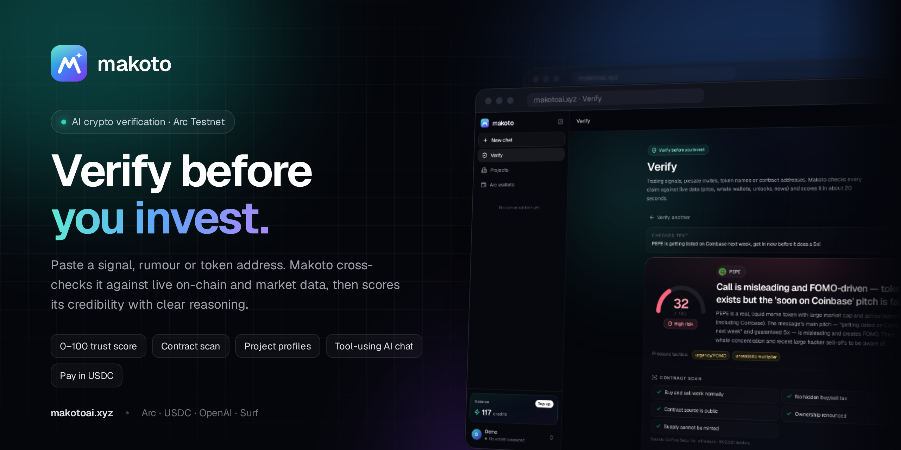
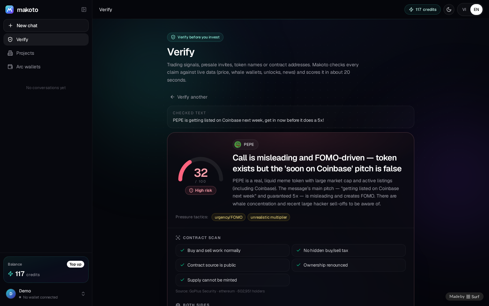
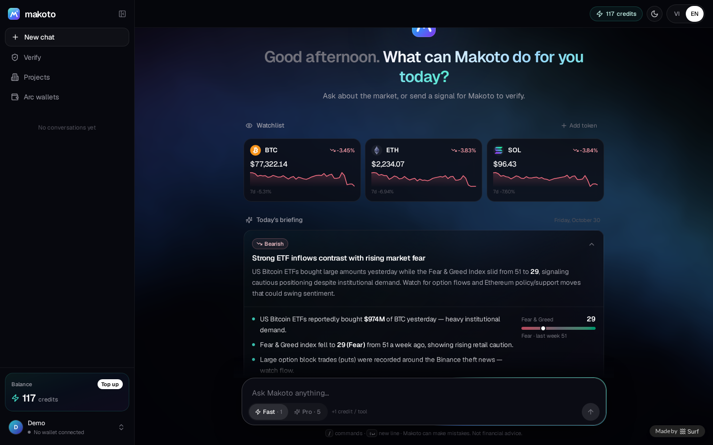
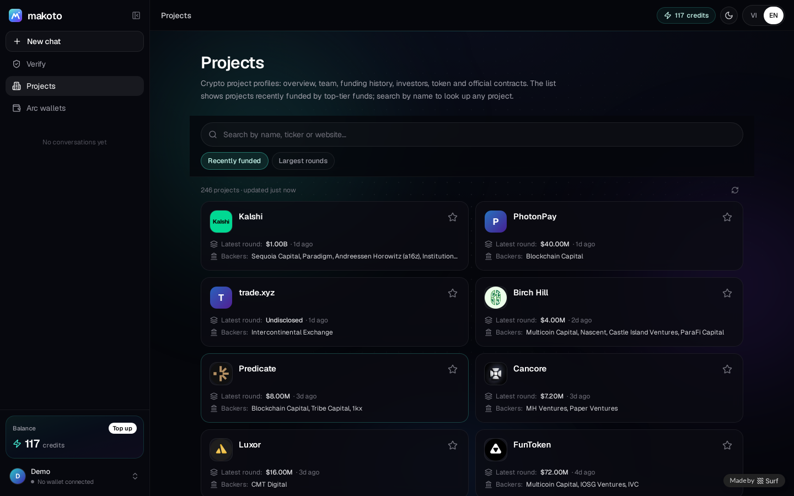
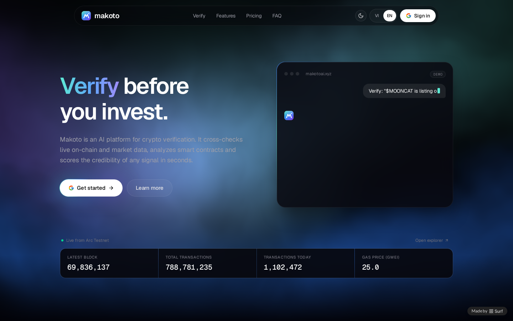
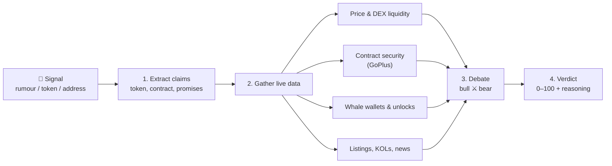
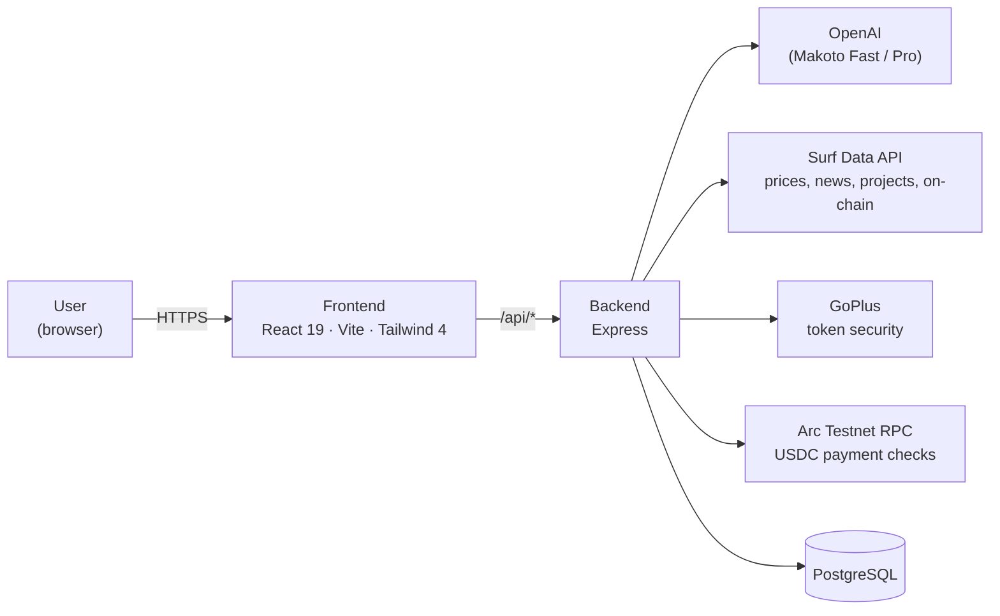

<div align="center">



<br />

# Makoto

**AI-powered verification for crypto signals.**
Paste a trading signal, rumour or token address. Makoto cross-checks it against live on-chain and market data and returns a **0–100 trust score** with clear reasoning.

[](https://makotoai.xyz)
[](https://explorer.testnet.arc.io)
[](https://faucet.circle.com)

[](https://react.dev)
[](https://vitejs.dev)
[](https://tailwindcss.com)
[](https://expressjs.com)
[](https://www.postgresql.org)
[](https://openai.com)

[Try it](https://makotoai.xyz) · [Features](#-features) · [How it works](#-how-verification-works) · [Run locally](#-run-locally) · [Security](#-security)

</div>

---

## ✨ Overview

Crypto is full of "alpha calls": *"listing on Binance soon"*, *"whales are accumulating"*, *"10x this week"*. Most of them can't be verified, and newcomers are usually the ones who pay for it.

**Makoto** lets you check before you buy. Instead of going on gut feeling, Makoto:

1. breaks a signal into individual claims;
2. checks each claim against real data: price, token contract, whale wallets, unlock schedule, exchange listings and news;
3. has a bull side and a bear side argue it out;
4. only then gives its score.

- 🔐 **Sign in with Google**: 20 free credits, no wallet required.
- 💳 **Top up with USDC on Arc Testnet**, paid directly from your own wallet with no middleman.
- 🌐 **Full English and Vietnamese support**, light and dark themes, mobile-friendly.

## 🧩 Features

| | Feature | Description |
|---|---|---|
| 🛡️ | **Signal verification** | 0–100 trust score. Each claim is rated true, false or misleading. Flags manipulation tactics: guaranteed returns, urgency pressure, requests to send funds. |
| 🔬 | **Contract analysis** | Honeypot detection, buy/sell tax, owner privileges, holder concentration, DEX liquidity and token unlock schedule. |
| 💬 | **Tool-using AI assistant** | Prices, market rankings, news, the Fear & Greed index, web research, and Arc wallets and transactions. Every answer is grounded in data fetched in real time. |
| 📁 | **Project profiles** | Overview, team (with cross-checked X accounts), funding history, investors, token, contracts and official links (website, X, Telegram, Discord, GitHub…). |
| 📰 | **Daily briefing & watchlist** | A daily market briefing, plus a watchlist of up to 12 tokens with price, 24h change and 7-day trend. Free. |
| ⛓️ | **Arc wallet explorer** | Balances, tokens and transactions for any address on Arc Testnet. |
| 🧠 | **Personal memory** | Makoto remembers your preferences to give more relevant answers. View, edit, delete or turn it off at any time. |

## 📸 Screenshots

<table>
  <tr>
    <td width="50%"><p align="center"><b>Verify</b>: trust score and detailed analysis</p></td>
    <td width="50%"><p align="center"><b>Home</b>: watchlist and daily briefing</p></td>
  </tr>
  <tr>
    <td width="50%"><p align="center"><b>Projects</b>: recently funded projects</p></td>
    <td width="50%"><p align="center"><b>Landing page</b></p></td>
  </tr>
</table>

## 🔍 How verification works



1. **Extract claims.** The model reads the signal and pulls out the token, contract address and each specific promise.
2. **Gather data.** Sources are queried in parallel. If one source fails it is skipped, and the rest are still used.
3. **Debate.** One side argues for the signal and the other against it, using only the evidence collected.
4. **Verdict.** A trust score, a ruling on each claim, any manipulation flags, and practical advice.

> You are only charged when a result is delivered. If a verification fails, no credits are used.

## 💳 Credits

| Action | Cost |
|---|---|
| Ask **Makoto Fast** | 1 credit + 1 credit per tool used |
| Ask **Makoto Pro** (deeper analysis) | 5 credits + 2 credits per tool used |
| **Verify** a signal | 3 credits |
| Briefing, watchlist, project profiles | Free |

New accounts get **20 free credits**. Top up with USDC on Arc Testnet:

| Pack | USDC | Credits | Bonus |
|---|---:|---:|---:|
| Small | 1 | 100 | — |
| Medium | 5 | 550 | +10% |
| Large | 10 | 1,200 | +20% |
| XL | 25 | 3,250 | +30% |

USDC goes directly to the Makoto treasury wallet [`0x1629…586b`](https://explorer.testnet.arc.io/address/0x16299b74c616994eaecb9b20e37d369d5d62586b). The server reads the transaction on-chain before adding credits, and each transaction can only be credited once. Get free test USDC at [faucet.circle.com](https://faucet.circle.com).

## 🏗️ Architecture



| Layer | Technology |
|---|---|
| Frontend | React 19, Vite, Tailwind CSS 4, TanStack Query, Motion, ECharts, lucide-react |
| Backend | Node.js, Express, Surf SDK, viem |
| Database | PostgreSQL (Drizzle schema) |
| AI | OpenAI, called server-side with streamed responses |
| Data | Surf Data API, GoPlus Security, CoinGecko, Arc Testnet RPC |
| Auth | Google Sign-In. A wallet (MetaMask, Rabby, WalletConnect) is only needed for USDC top-ups. |

### Project structure

```
.
├── frontend/                 # Web app (Vite + React)
│   └── src/
│       ├── components/makoto/
│       │   ├── landing/      # Landing page
│       │   ├── chat/         # AI assistant, home, briefing
│       │   ├── verify/       # Signal verification & reports
│       │   └── project/      # Project profiles
│       └── lib/              # Session, i18n, wallet, formatting
├── backend/                  # API (Express)
│   ├── routes/               # Auto-mounted at /api/<file name>
│   ├── lib/                  # Agent, tools, verification, payments, Arc
│   └── db/schema.js          # Database tables
└── docs/                     # README images
```

## 🚀 Run locally

**Requirements:** Node.js 20+ or [Bun](https://bun.sh), PostgreSQL, and the API keys below.

```bash
git clone https://github.com/congthuat/Makoto-Ai-Arc-Testnet-.git
cd Makoto-Ai-Arc-Testnet-

# Backend
cd backend
cp .env.example .env        # fill in the environment variables
bun install
bun run dev                 # http://localhost:3001

# Frontend (in a second terminal)
cd ../frontend
cp .env.example .env
bun install
bun run dev                 # http://localhost:5173
```

| Variable | Description |
|---|---|
| `OPENAI_API_KEY` | OpenAI key, **server-side only** |
| `SURF_API_KEY` | Surf Data API key (market data & database) |
| `GOOGLE_CLIENT_ID` | OAuth Web client ID, ending in `.apps.googleusercontent.com` |
| `TREASURY_ADDRESS` | Wallet that receives USDC top-ups |
| `BACKEND_PORT` | Backend port, default `3001` |

> ⚠️ Never commit your `.env` file. It is already listed in `.gitignore`.

## 🔒 Security

- The OpenAI key and all other API keys live on the server only and are never sent to the browser.
- Makoto **never** asks for a private key or seed phrase. Top-ups are transactions you sign in your own wallet.
- Every USDC payment is checked on-chain (correct sender, correct recipient, correct amount) and credited only once.
- Credits are held up front and only what was actually used is charged. Failed tools and failed verifications are free.
- Server errors never expose internal details. The assistant can only read public web pages and cannot reach internal networks.

---

<div align="center">

**[makotoai.xyz](https://makotoai.xyz)**

<sub>⚠️ Makoto provides information for reference only and is <b>not financial advice</b>. Always do your own research (DYOR).</sub>

</div>
