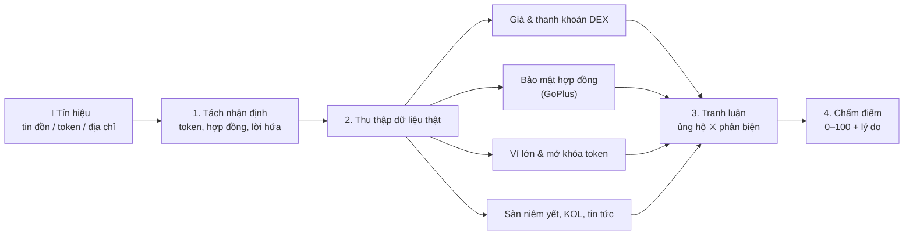
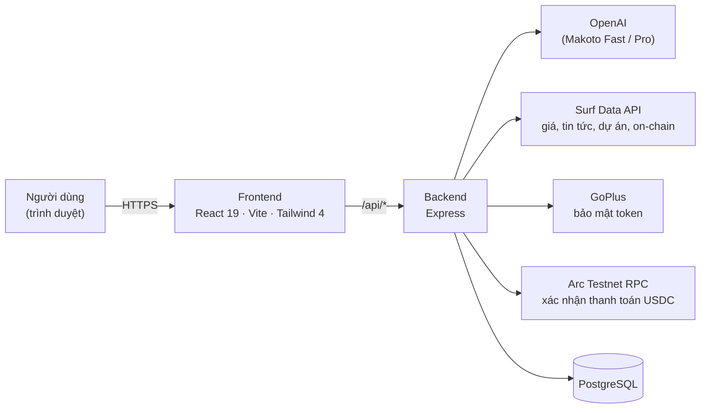

<div align="center">


<br />

# Makoto

**Nền tảng AI xác minh thông tin crypto cho người Việt.**
Dán một tín hiệu, tin đồn hay địa chỉ token. Makoto đối chiếu với dữ liệu on-chain và thị trường thật, rồi trả về **điểm tin cậy 0–100** kèm lý do rõ ràng.

[](https://makotoai.xyz)
[](https://explorer.testnet.arc.io)
[](https://faucet.circle.com)

[](https://react.dev)
[](https://vitejs.dev)
[](https://tailwindcss.com)
[](https://expressjs.com)
[](https://www.postgresql.org)
[](https://openai.com)

[Dùng thử](https://makotoai.xyz) · [Tính năng](#-tính-năng) · [Cách hoạt động](#-cách-makoto-xác-minh) · [Chạy local](#-chạy-local) · [English](#-english)

</div>

---

## ✨ Giới thiệu

Thị trường crypto đầy "kèo": *"sắp list Binance"*, *"cá voi đang gom"*, *"x10 trong tuần"*. Phần lớn không kiểm chứng được, và người mới thường là người chịu thiệt.

**Makoto** giúp bạn kiểm tra trước khi xuống tiền. Thay vì đọc cảm tính, Makoto tách tín hiệu thành từng nhận định, đối chiếu với dữ liệu thực (giá, hợp đồng token, ví lớn, lịch mở khóa, sàn niêm yết, tin tức), cho hai phe ủng hộ và phản biện tranh luận, rồi mới chấm điểm.

- 🔐 Đăng nhập bằng **Google**, tặng **20 credit** miễn phí, **không cần ví**.
- 💳 Nạp thêm credit bằng **USDC trên Arc Testnet**: thanh toán thẳng từ ví của bạn, không qua trung gian.
- 🇻🇳 Hỗ trợ đầy đủ **tiếng Việt** và **tiếng Anh**, giao diện sáng / tối, dùng tốt trên điện thoại.

## 🧩 Tính năng

| | Tính năng | Mô tả |
|---|---|---|
| 🛡️ | **Xác minh tín hiệu** | Chấm điểm tin cậy 0–100. Kiểm từng nhận định (đúng / sai / gây hiểu lầm), nhận diện chiêu dụ dỗ (hứa lãi, hối thúc, đòi chuyển tiền). |
| 🔬 | **Phân tích hợp đồng** | Honeypot, thuế mua/bán, quyền chủ hợp đồng, độ tập trung của ví lớn, thanh khoản DEX, lịch mở khóa token. |
| 💬 | **Trợ lý AI có công cụ** | Hỏi giá, bảng xếp hạng, tin tức, chỉ số Sợ hãi & Tham lam, tra cứu web, ví và giao dịch trên Arc. Mỗi câu trả lời đều dựa trên dữ liệu được truy xuất theo thời gian thực. |
| 📁 | **Hồ sơ dự án** | Giới thiệu, đội ngũ (kèm tài khoản X đã được đối chiếu), lịch sử gọi vốn, quỹ đầu tư, token, hợp đồng và liên kết chính thức (website, X, Telegram, Discord, GitHub…). |
| 📰 | **Bản tin & danh sách theo dõi** | Bản tin thị trường mỗi ngày và theo dõi tối đa 12 token với giá, biến động 24h, xu hướng 7 ngày. Miễn phí. |
| ⛓️ | **Ví trên Arc** | Xem số dư, token và giao dịch của bất kỳ địa chỉ nào trên Arc Testnet. |
| 🧠 | **Trí nhớ cá nhân** | Makoto nhớ sở thích của bạn để trả lời sát hơn. Bạn xem, sửa, xóa hoặc tắt bất cứ lúc nào. |

## 📸 Ảnh chụp màn hình

<table>
  <tr>
    <td width="50%"><p align="center"><b>Xác minh</b>: điểm tin cậy và phân tích chi tiết</p></td>
    <td width="50%"><p align="center"><b>Trang chính</b>: danh sách theo dõi và bản tin</p></td>
  </tr>
  <tr>
    <td width="50%"><p align="center"><b>Dự án</b>: các dự án vừa gọi vốn</p></td>
    <td width="50%"><p align="center"><b>Trang giới thiệu</b></p></td>
  </tr>
</table>

## 🔍 Cách Makoto xác minh



1. **Tách nhận định**: AI đọc tín hiệu và rút ra token, địa chỉ hợp đồng, các lời hứa cụ thể.
2. **Thu thập dữ liệu**: lấy song song từ nhiều nguồn. Nguồn nào lỗi thì bỏ qua, các nguồn còn lại vẫn được dùng.
3. **Tranh luận**: một phe tìm điểm mạnh, một phe tìm điểm yếu, chỉ dựa trên bằng chứng đã thu thập.
4. **Chấm điểm**: điểm tin cậy, kết luận cho từng nhận định, dấu hiệu thao túng và lời khuyên.

> Chỉ trừ credit khi có kết quả. Nếu xác minh thất bại, bạn không mất credit nào.

## 💳 Credit

| Hành động | Chi phí |
|---|---|
| Hỏi **Makoto Fast** | 1 credit + 1 credit cho mỗi công cụ được dùng |
| Hỏi **Makoto Pro** (phân tích sâu hơn) | 5 credit + 2 credit cho mỗi công cụ được dùng |
| **Xác minh** một tín hiệu | 3 credit |
| Bản tin, danh sách theo dõi, hồ sơ dự án | Miễn phí |

Tài khoản mới được tặng **20 credit**. Nạp thêm bằng USDC trên Arc Testnet:

| Gói | USDC | Credit | Thưởng |
|---|---:|---:|---:|
| Gói nhỏ | 1 | 100 | — |
| Gói vừa | 5 | 550 | +10% |
| Gói lớn | 10 | 1.200 | +20% |
| Gói rất lớn | 25 | 3.250 | +30% |

USDC được chuyển thẳng tới ví kho bạc Makoto [`0x1629…586b`](https://explorer.testnet.arc.io/address/0x16299b74c616994eaecb9b20e37d369d5d62586b). Máy chủ đọc giao dịch trên chuỗi để xác nhận rồi mới cộng credit; mỗi giao dịch chỉ được cộng một lần. Nhận USDC thử nghiệm miễn phí tại [faucet.circle.com](https://faucet.circle.com).

## 🏗️ Kiến trúc



| Lớp | Công nghệ |
|---|---|
| Frontend | React 19, Vite, Tailwind CSS 4, TanStack Query, Motion, ECharts, lucide-react |
| Backend | Node.js, Express, Surf SDK, viem |
| Cơ sở dữ liệu | PostgreSQL (schema Drizzle) |
| AI | OpenAI, gọi từ máy chủ, trả lời dạng stream |
| Dữ liệu | Surf Data API, GoPlus Security, CoinGecko, Arc Testnet RPC |
| Đăng nhập | Google Sign-In; ví (MetaMask, Rabby, WalletConnect) chỉ để nạp USDC |

### Cấu trúc thư mục

```
.
├── frontend/                 # Ứng dụng web (Vite + React)
│   └── src/
│       ├── components/makoto/
│       │   ├── landing/      # Trang giới thiệu
│       │   ├── chat/         # Trợ lý AI, trang chính, bản tin
│       │   ├── verify/       # Xác minh tín hiệu & báo cáo
│       │   └── project/      # Hồ sơ dự án
│       └── lib/              # Phiên đăng nhập, i18n, ví, định dạng
├── backend/                  # API (Express)
│   ├── routes/               # Tự động gắn vào /api/<tên file>
│   ├── lib/                  # Agent, công cụ, xác minh, thanh toán, Arc
│   └── db/schema.js          # Bảng dữ liệu
└── docs/                     # Ảnh dùng trong README
```

## 🚀 Chạy local

**Yêu cầu:** Node.js 20+ hoặc [Bun](https://bun.sh), PostgreSQL, và các khóa API bên dưới.

```bash
git clone https://github.com/congthuat/Makoto-Ai-Arc-Testnet-.git
cd Makoto-Ai-Arc-Testnet-

# Backend
cd backend
cp .env.example .env        # điền các biến môi trường
bun install
bun run dev                 # http://localhost:3001

# Frontend (cửa sổ terminal khác)
cd ../frontend
cp .env.example .env
bun install
bun run dev                 # http://localhost:5173
```

| Biến môi trường | Mô tả |
|---|---|
| `OPENAI_API_KEY` | Khóa OpenAI, **chỉ dùng ở máy chủ** |
| `SURF_API_KEY` | Khóa Surf Data API (dữ liệu thị trường & cơ sở dữ liệu) |
| `GOOGLE_CLIENT_ID` | OAuth Client ID loại Web, dạng `….apps.googleusercontent.com` |
| `TREASURY_ADDRESS` | Ví nhận USDC khi người dùng nạp credit |
| `BACKEND_PORT` | Cổng backend, mặc định `3001` |

> ⚠️ Không bao giờ commit file `.env`. File này đã nằm trong `.gitignore`.

## 🔒 Bảo mật

- Khóa OpenAI và mọi khóa API chỉ nằm ở máy chủ, không bao giờ gửi xuống trình duyệt.
- Makoto **không bao giờ** yêu cầu private key hay cụm từ khôi phục (seed phrase). Nạp tiền là giao dịch bạn tự ký trong ví của mình.
- Mỗi giao dịch USDC được kiểm tra trên chuỗi (đúng người gửi, đúng ví nhận, đúng số tiền) và chỉ được cộng credit một lần.
- Credit được giữ trước rồi trừ đúng phần đã dùng. Công cụ bị lỗi hay xác minh thất bại thì không tính tiền.
- Lỗi máy chủ không làm lộ thông tin kỹ thuật bên trong. Trợ lý chỉ đọc được các trang web công khai, không truy cập được mạng nội bộ.

## 🌐 English

**Makoto** is an AI platform for verifying crypto information, built for Vietnamese users (full English support included). Paste a trading signal, rumour or token address: Makoto breaks it into individual claims and checks each one against live market and on-chain data (prices, DEX liquidity, GoPlus contract security, whale concentration, token unlocks, exchange listings, KOL wallets, news). It runs a bull-vs-bear debate grounded in that evidence and returns a **0–100 trust score** with clear reasoning.

It also includes a tool-using AI assistant, project profiles (team, funding, investors, official links), a free daily briefing and watchlist, an Arc wallet explorer and personal memory. Sign in with Google and get 20 free credits; top up with **USDC on Arc Testnet**, sent directly from your own wallet.

**Stack:** React 19 · Vite · Tailwind CSS 4 · Express · PostgreSQL · OpenAI · Surf Data API · viem · Arc Testnet.

---

<div align="center">

**[makotoai.xyz](https://makotoai.xyz)**

<sub>⚠️ Makoto cung cấp thông tin tham khảo, <b>không phải lời khuyên đầu tư</b>. Hãy luôn tự nghiên cứu (DYOR) trước khi quyết định.</sub>

</div>
